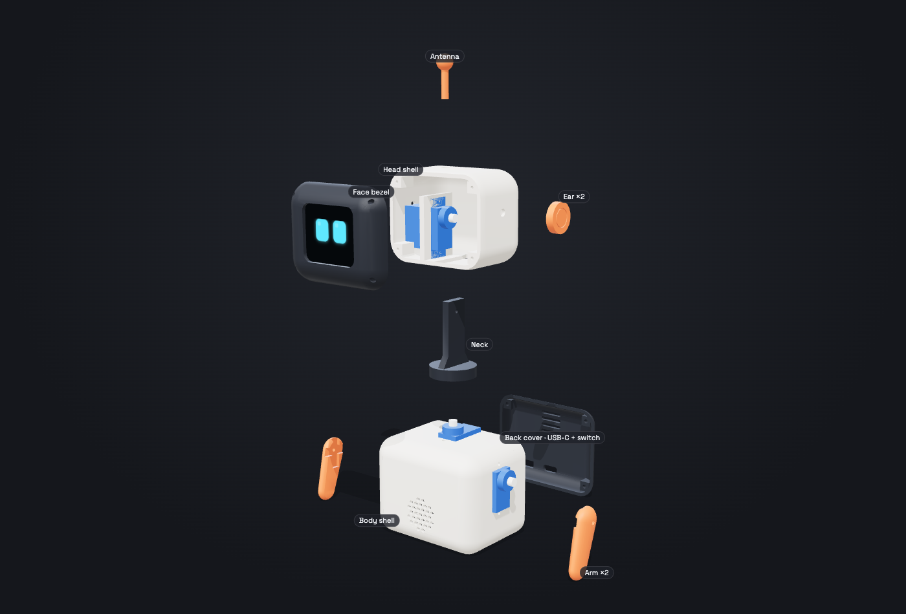
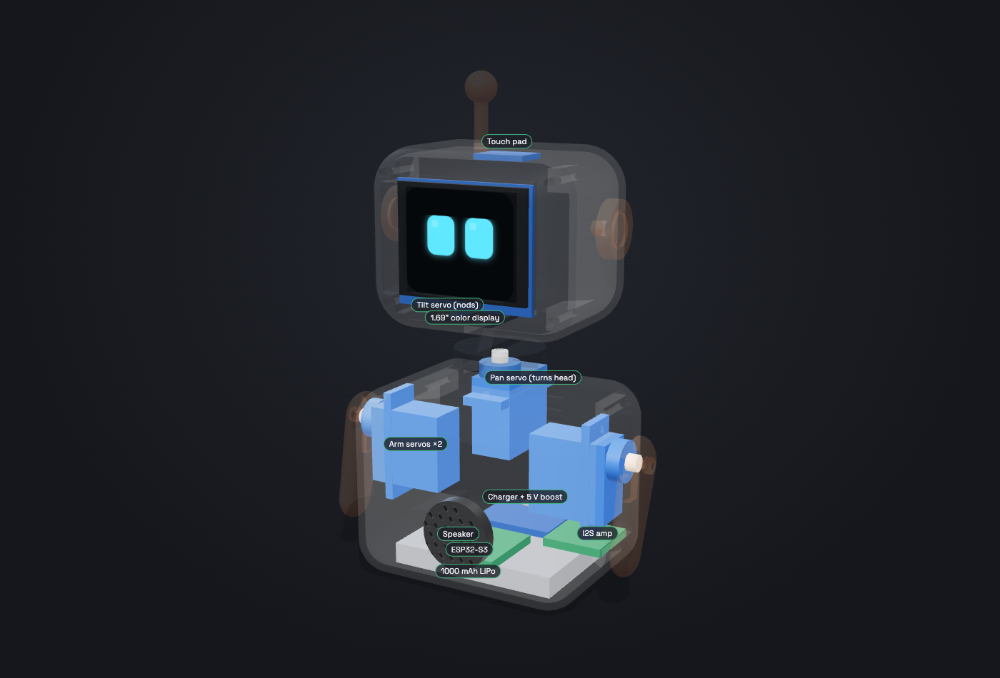

# Pip — a small desk robot with expressions


Pip is a 14 cm tall desk robot. It has a color screen for a face (eyes, mouth, blush, hearts), a head that turns and nods, two arms that wave, a speaker for chirps, and a touch pad on its head so you can "pet" it. Everything except the electronics is 3D printed.

| See it | File |
|---|---|
| Interactive 3D viewer (open in Chrome, needs internet for three.js) | `viewer/index.html` |
| Printable parts | `stl/*.stl` |
| Change sizes and regenerate parts | `parts/make_parts.py` |
| Pictures | `images/` |

The 3D viewer is built from the actual STL geometry, so what you see is what you print.

---

## 1. What it can do (v1)

- **8 expressions**: neutral, happy, sad, angry, surprised, sleepy, love, curious. Plus blinking and looking around.
- **Body language**: head turns ±60°, nods ±15°, each arm swings 0–120°. Every expression has a matching pose (happy = waves arms, sad = looks down, surprised = arms up).
- **Touch**: tap the top of the head → it giggles and looks happy.
- **Sound**: short chirps and beeps through a small speaker.
- **Battery**: about 1.5–2 hours of active play from a 1000 mAh cell; charges over USB-C.


---

## 2. Shopping list

Prices are rough (Robu.in / Amazon.in, or AliExpress / Amazon US).

| # | Part | Why | ₹ | $ |
|---|---|---|---|---|
| 1 | **ESP32-S3 Super Mini** | The brain. Tiny, has Wi-Fi + Bluetooth | 450 | 5 |
| 1 | **1.69" ST7789 color IPS display, 240×280** (SPI) | The face | 450 | 7 |
| 4 | **SG90 micro servo** (9 g, plastic gears is fine) | Pan, tilt, 2 arms | 520 | 10 |
| 1 | **1000 mAh 1S LiPo, 503450 size** (50×34×5 mm) | Power | 350 | 8 |
| 1 | **IP5306 USB-C charge + 5 V boost module** (2 A) | Charges the battery and makes 5 V | 150 | 4 |
| 1 | **MAX98357A I2S amp** | Drives the speaker | 250 | 6 |
| 1 | **20 mm 8 Ω speaker** (≤ 4 mm thick) | Chirps | 60 | 2 |
| 1 | **TTP223 touch module** | Senses a pat through the plastic | 25 | 1 |
| 1 | **Mini slide switch** (SS12D00) | On/off | 10 | 1 |
| 1 | **1000 µF 10 V capacitor** | Stops the servos from resetting the ESP32 | 15 | 1 |
| ~12 | **M2 × 8 self-tapping screws** | Covers + servo tabs | 80 | 3 |
| — | Silicone wire (26 AWG), heat-shrink, 4 rubber feet | | 120 | 4 |
| ~80 g | **PLA filament**: cream, charcoal, orange | The shell | 150 | 2 |
| | **Total** | | **≈ ₹2,600** | **≈ $55** |

Optional for v2: MPU6050 / QMI8658 motion sensor (knows when it's picked up or shaken), INMP441 microphone (hears claps and voice).

---

## 3. Printing



| Part | Qty | Color | Size (mm) | Lays on the bed… |
|---|---|---|---|---|
| `body_shell` | 1 | cream | 70 × 55 × 48 | front face down (open back faces up) |
| `back_cover` | 1 | charcoal | 70 × 55 × 8 | flat back down |
| `head_shell` | 1 | cream | 62 × 50 × 40 | back face down (open front faces up) |
| `face_bezel` | 1 | charcoal | 61 × 49 × 8 | face down |
| `neck` | 1 | charcoal | 26 × 26 × 42 | disc down |
| `arm_x2` | **2** | orange | 38 × 19 × 7 | flat side down |
| `ear_x2` | **2** | orange | 16 × 16 × 8 | as exported |
| `antenna` | 1 | orange | 9 × 9 × 24 | ball up |

Every STL is already turned to the right orientation, so you just drop it on the bed.

**Settings (any FDM printer, e.g. Bambu A1 mini, Ender 3, Prusa Mini):** PLA, 0.2 mm layers, 3 walls, 15% infill. Turn on **tree supports, "touching build plate only"** for the body and head, because their rounded edges curve away from the bed. Everything else prints without supports. Total about 80 g and 7–8 hours.

**Print a test first:** print only `face_bezel` and `back_cover` (≈ 1 h) and check that your display fits the window and your servos fit their windows. Sizes of cheap displays and servos vary by ±0.5 mm. If something is tight, change the number at the top of `parts/make_parts.py` and regenerate:

```bash
cd pip-bot
.venv/bin/python parts/make_parts.py      # rewrites stl/ and the viewer data
```

(First time only: `python3.12 -m venv .venv && .venv/bin/pip install manifold3d numpy`.)

---

## 4. What goes where



- **Body floor:** the battery lies flat. The ESP32 (front) and charger board (back, USB-C lined up with the back-cover hole) sit on top of it with double-sided foam tape. The amp sits beside the charger.
- **Body ceiling:** the pan servo hangs upside down from the ceiling, screwed through its tabs. Its shaft pokes out the top and turns the neck.
- **Body sides:** one arm servo in each side wall, shaft pointing out. The arm screws onto the servo horn.
- **Body front:** speaker glued behind the round grille.
- **Neck:** a disc that presses onto the pan servo's cross horn, with an upright fin. The tilt servo's horn screws to the fin.
- **Head:** the tilt servo sits in an upright cradle inside the head. The display presses into a frame on the back of the face bezel. The touch module is glued under the head's ceiling — it senses a finger through 2 mm of PLA.
- **Cables** from the head go down through the slot in the head floor and the round hole in the body ceiling. Leave a loose loop so the head can turn.

### Wiring

```
                 ┌──────────── 5 V rail ──────────────┐
LiPo ─ switch ─ IP5306 (USB-C) ─ 5V ─┬─ ESP32 5V pin   │
                                     ├─ 4× servo red   │ + 1000 µF cap across 5V/GND
                                     └─ MAX98357A VIN  │
                 └──────────── GND (all together) ────┘
```

| From | ESP32-S3 pin |
|---|---|
| Display SCK / MOSI / CS / DC / RST / backlight | GPIO 12 / 11 / 10 / 9 / 8 / 7 |
| Display VCC / GND | 3V3 / GND |
| Pan servo signal / tilt / left arm / right arm | GPIO 1 / 2 / 3 / 4 |
| Amp BCLK / LRC / DIN | GPIO 5 / 6 / 13 |
| Touch module OUT (VCC to 3V3) | GPIO 44 |

Rule: **servos get 5 V from the boost module, never from the ESP32's 3V3 pin.** Four servos moving together can draw 1.5 A, which is why the big capacitor is there.

---

## 5. Assembly order

1. **Center all servos first.** Flash a tiny sketch that sets all four to 90°. Do this before attaching any horns or arms, so "90°" means "straight ahead / arms down".
2. **Body:** screw the pan servo to the ceiling and the two arm servos into the side walls (servo tabs inside, 2 screws each).
3. **Power:** solder battery → switch → IP5306. Put the 1000 µF capacitor across 5 V and GND. Test with a multimeter: 5 V out, charges on USB-C.
4. **Brain:** wire the ESP32, amp and speaker. Tape the boards down on top of the battery.
5. **Head:** screw the tilt servo into the cradle. Press the display into the bezel frame. Glue the touch module under the ceiling. Run the head cables through the floor slot.
6. **Neck:** press the cross horn into the neck disc (screw from below), push it onto the pan servo. Screw the tilt servo horn onto the fin.
7. Close the face bezel (4 screws) and the back cover (4 screws). Push on the ears and antenna (a drop of glue). Screw on the arms.
8. Stick 4 rubber feet on the bottom.

---

## 6. Software plan

Use **Arduino IDE or PlatformIO**, with these libraries: **LovyanGFX** (fast display drawing), **ESP32Servo**, and the ESP-IDF I2S driver for sound.

| Step | What | Done when |
|---|---|---|
| 1 | Display test | Shows color bars |
| 2 | **Eye engine**: port `drawFace()` from `viewer/index.html` to C++. It draws into a 280×240 off-screen sprite, then pushes it to the screen, so there's no flicker. Same numbers: eye width/height/corner, slanted top lids, rising bottom lid, color | All 8 expressions + blink at 30 fps |
| 3 | **Motion engine**: smoothly ease each servo toward a target (same as `pose()` in the viewer). Limit tilt to ±15°, pan to ±60° | Pose matches each expression, no jerks |
| 4 | **Sounds**: 6–8 short WAV chirps stored in flash, one per mood | Happy chirp on touch |
| 5 | **Personality loop**: idle (looks around, blinks) → touched = happy → nobody for 5 min = sleepy → touch wakes it up = surprised then happy | Feels alive for 10 minutes on a desk |
| 6 | **Wi-Fi remote**: tiny web page on the robot with the 8 expression buttons | Control from your phone |

v2 ideas: motion sensor (dizzy face when shaken, scared when lifted), microphone (turns toward a clap), clock/weather face, voice chat through the Claude API.

---

## 7. Milestones

| Week | Goal |
|---|---|
| 1 | Order parts. Print the test pieces (bezel + back cover). Display + one servo working on a breadboard |
| 2 | Print all parts. Eye engine running on the real display |
| 3 | Full assembly, motion engine, touch, sound |
| 4 | Personality loop, Wi-Fi remote, polish |

## 8. Things that may need a tweak

- **Display size** varies between sellers. Measure yours and update `DISPLAY_WIN` / `DISPLAY_PANEL` in `make_parts.py`.
- **Servo horns** vary. The horn pockets in the arm and neck are for the standard SG90 cross / single horns; widen them by 0.2 mm if tight.
- **Battery thickness:** buy ≤ 6 mm (the 503450 size).
- The tilt mount (servo cradle + neck fin) is the most likely part to need a second version once you hold the real servo.
