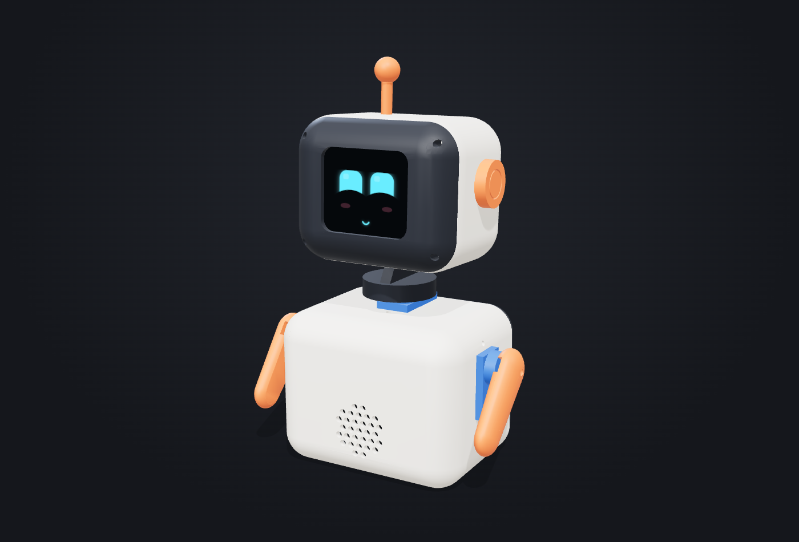
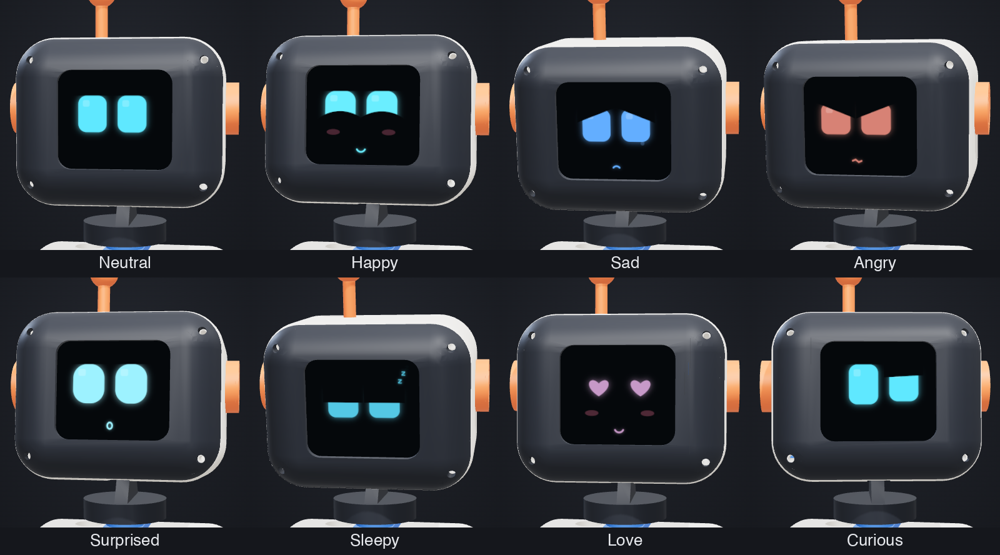

# Pip — a small desk robot

A 14 cm desk robot with a color-screen face (8 expressions), a head that turns and nods, waving arms, touch and sound. ESP32-S3 + 4 SG90 servos, fully 3D printed.

- **Live 3D viewer:** https://kanurkarprateek.github.io/pip-bot/viewer/
- **Electronics guide** (wiring, soldering, testing, fixing problems): https://kanurkarprateek.github.io/pip-bot/guide/
- **Hardware test programs:** [`firmware/tests/`](firmware/tests/)
- **Build plan** (parts list, printing, wiring, assembly, software): [PLAN.md](PLAN.md)
- **Printable parts:** [`stl/`](stl/), generated by [`parts/make_parts.py`](parts/make_parts.py)

